# Spate

Aplicativo mobile em Flutter para **previsão e alertas de enchentes, deslizamentos, incêndios e ondas de calor**, com orientações direcionadas à população brasileira.

Projeto da **Global Solution 2026**, FIAP.

**Repositório no GitHub:** https://github.com/yasvazz/Spate---Global-Solution-2026

## Desenvolvedores

| Nome completo | RM |
|---|---|
| Yasmin Vaz De Siqueira | RM556763 |
| João Vinicius Hotz Nascimento | RM556402 |

## Descrição da solução

Eventos climáticos extremos afetam milhões de brasileiros todos os anos, e muitas vezes a população só descobre o risco quando ele já aconteceu. O Spate reúne, em um só lugar:

- **Previsão de risco** para 12 cidades brasileiras, calculada a partir de chuva, temperatura e vento previstos.
- **Eventos monitorados por satélite** na América do Sul, fornecidos pela NASA.
- **Orientações de segurança** e contatos de emergência (Defesa Civil 199 e Bombeiros 193) em cada alerta.

Os níveis de risco (baixo, moderado, alto, muito alto) são estimativas simplificadas, inspiradas em critérios públicos, e **não substituem os alertas oficiais**.

## Tema da Global Solution

- **Tema:** Indústria Espacial.
- **Conexão com o tema:** uso de dados de observação da Terra por satélite (NASA EONET) e de modelos de previsão meteorológica para antecipar riscos.
- **ODS relacionados:** ODS 9 (Indústria, Inovação e Infraestrutura), ODS 11 (Cidades e Comunidades Sustentáveis) e ODS 13 (Ação Contra a Mudança Global do Clima).

## Fluxo de telas

```
Splash
  ├─ introdução ainda não ocultada ──► Onboarding (3 páginas) ──► Home
  └─ "Não mostrar novamente" salvo ──► Home

Home
  ├─ cartão de um tipo de risco ──► Alertas (já filtrado pela categoria)
  ├─ "Ver todos os alertas" ──────► Alertas
  ├─ Favoritos ───────────────────► Favoritos ──► Detalhe do alerta
  └─ Sobre ───────────────────────► Sobre

Alertas ──► Detalhe do alerta
```

## Prints das telas

| Splash | Onboarding 1 | Onboarding 2 | Onboarding 3 |
|---|---|---|---|
| 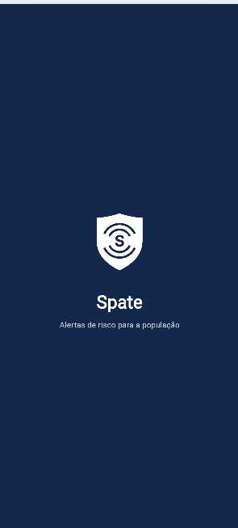 | 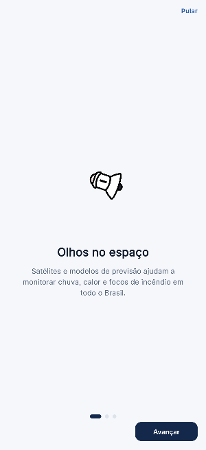 | 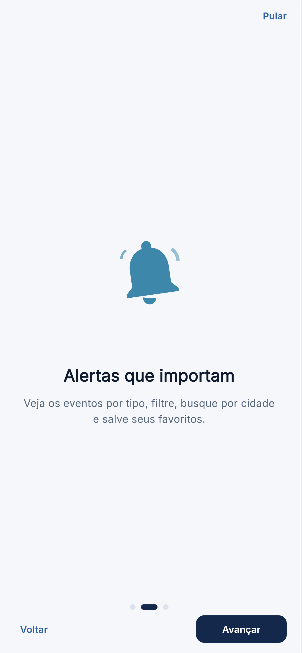 | 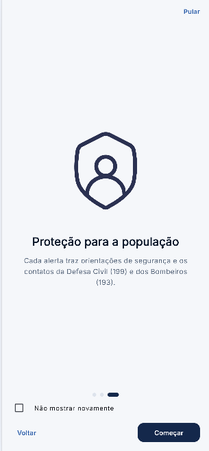 |

| Home | Alertas | Filtro por categoria |
|---|---|---|
| 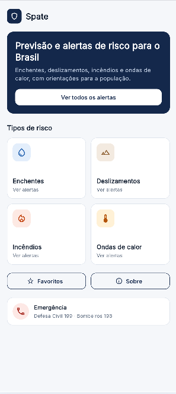 | 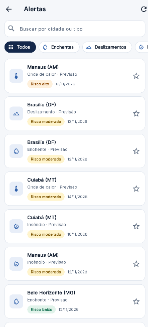 | 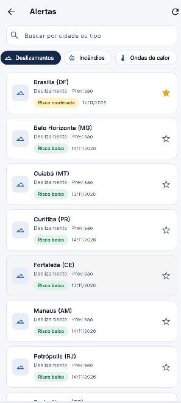 |

| Detalhe (enchente) | Detalhe (incêndio) | Favoritos | Sobre |
|---|---|---|---|
| 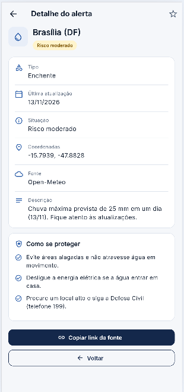 | 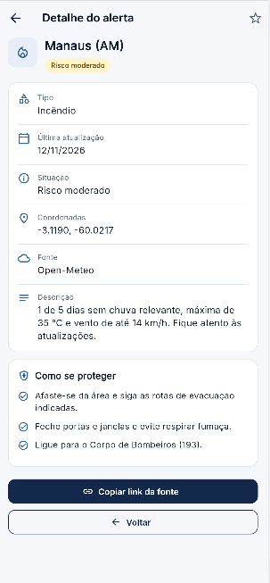 | 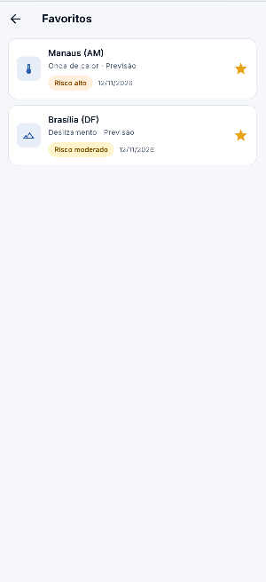 | 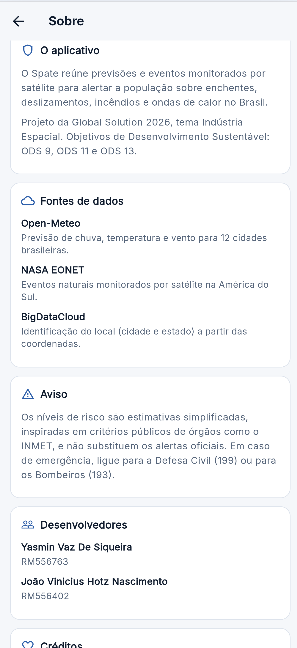 |

## APIs utilizadas

Todas são públicas e não exigem chave.

| API | Uso no app |
|---|---|
| [Open-Meteo](https://open-meteo.com/) | Previsão diária de chuva, temperatura máxima e vento para 12 cidades. Base do cálculo de risco. |
| [NASA EONET v3](https://eonet.gsfc.nasa.gov/) | Eventos naturais (enchentes, deslizamentos, incêndios e temperaturas extremas) monitorados por satélite na América do Sul. |
| [BigDataCloud](https://www.bigdatacloud.com/) | Geocodificação reversa: transforma as coordenadas de um evento em "Cidade, Estado, País". |

Cidades monitoradas: São Paulo, Rio de Janeiro, Belo Horizonte, Salvador, Recife, Fortaleza, Manaus, Porto Alegre, Curitiba, Brasília, Cuiabá e Petrópolis.

### Como o risco é calculado

Estimativas simplificadas, calculadas no app a partir da previsão do Open-Meteo:

| Tipo | Critério |
|---|---|
| Enchentes | Maior volume de chuva em um dia (mm) |
| Deslizamentos | Maior acumulado de chuva em 3 dias (mm) |
| Incêndios | Temperatura máxima, dias seguidos sem chuva e velocidade do vento |
| Ondas de calor | Maior temperatura máxima prevista (°C) |

## Arquitetura

O projeto separa interface, modelo, serviços e acesso a dados, e usa `setState` para o gerenciamento de estado.

```
lib/
├── main.dart                 Inicialização e tema do app
├── routes.dart               Rotas nomeadas (AppRotas)
├── model/
│   └── alerta.dart           Modelo de dados do alerta (fromJson, fromMap, toMap)
├── data/
│   ├── alertas_service.dart       Une previsões e eventos de satélite
│   ├── previsao_service.dart      Consome o Open-Meteo e calcula o nível de risco
│   ├── eonet_service.dart         Consome a NASA EONET
│   ├── localizacao_service.dart   Consome o BigDataCloud
│   └── preferencias_service.dart  SharedPreferences (introdução e favoritos)
├── components/               Widgets reutilizáveis
│   ├── alerta_card.dart
│   ├── selo_risco.dart
│   ├── categoria_chip.dart
│   ├── estado_carregando.dart
│   ├── estado_erro.dart
│   └── imagem_app.dart
├── screens/                  Telas
│   ├── splash_screen.dart
│   ├── onboarding_screen.dart
│   ├── home_screen.dart
│   ├── alertas_screen.dart
│   ├── detalhe_alerta_screen.dart
│   ├── favoritos_screen.dart
│   └── sobre_screen.dart
└── theme/
    └── app_theme.dart        Cores, tipografia e estilos
```

### Principais decisões

- **Estados da requisição:** a tela de Alertas controla quatro estados (`inicial`, `carregando`, `sucesso`, `erro`) com `setState`. Em caso de erro, mostra uma mensagem amigável e o botão **Tentar novamente**.
- **Persistência local (SharedPreferences):** guarda a opção "Não mostrar novamente" do Onboarding e a lista de favoritos.
- **Navegação:** rotas nomeadas para as telas principais. A Home envia a categoria escolhida como **argumento de rota** para a tela de Alertas, e a tela de Detalhe recebe o alerta por **parâmetro de construtor**.
- **Regras de risco nos serviços:** os cálculos de nível de risco ficam em `previsao_service.dart`, fora dos widgets.
- **Widgets reutilizáveis:** cartão de alerta, selo de risco, chip de categoria e estados de carregamento e erro.

## Requisitos da avaliação atendidos

| Requisito | Onde está |
|---|---|
| Splash com verificação via SharedPreferences | `splash_screen.dart` |
| Onboarding com 3 páginas, avançar/voltar e "Não mostrar novamente" | `onboarding_screen.dart` |
| Navegação com 4+ telas e passagem de parâmetros | Home, Alertas, Detalhe, Favoritos e Sobre |
| Consumo de WebService com `http`, models e 4 estados | `data/` e `alertas_screen.dart` |
| Widgets obrigatórios (Column, Row, Card, ListView/GridView, Scaffold, AppBar, botões, Icon/IconButton, Image.asset) | Presentes nas telas e componentes |
| 3+ interações | Abrir detalhe, buscar, filtrar por categoria, favoritar, atualizar, copiar link |

## Como executar

Pré-requisito: Flutter instalado.

```bash
flutter pub get
flutter run -d chrome
```

## Pacotes utilizados

`http`, `shared_preferences`, `google_fonts` e `lottie`.

## Créditos

- Animações do Onboarding: LottieFiles (licença gratuita).
- Ícones: Material Icons. Fonte: Inter (Google Fonts).